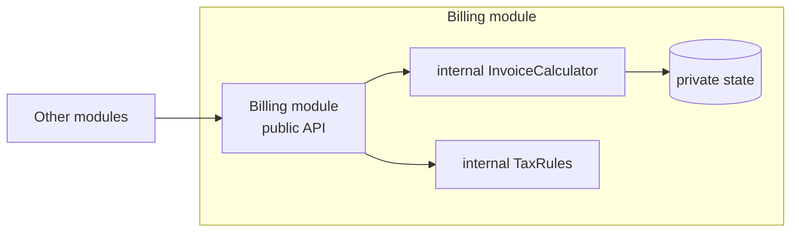

> [!summary] TL;DR
> A module bundles related elements behind a single conceptual boundary and exposes only what callers need. In JavaScript it historically meant closures (IIFE); in .NET it's namespaces, assemblies and `internal` visibility; at architecture level it's the basis of a modular monolith.

## Problem
- Without boundaries, every class can see and use every other class, so dependencies grow in all directions.
- Related functions and state are scattered and globally visible.

## Solution
- Group related elements into one unit with a clear name and purpose.
- Expose a small public API; keep the rest private or `internal`.
- Hide module state behind that API.
- Enforce boundaries with language features, assemblies, or architecture tests.

## Structure

![[Pasted image 20260607124540.png]]

## When to use / when not to
| Use when | Avoid when |
| --- | --- |
| Organizing a codebase into cohesive units | As a substitute for proper types in languages that have them (old JavaScript module idioms in TypeScript) |
| Hiding implementation details and state |  |
| Preparing boundaries for a [[Modular Monolith Architecture]] |  |

## Trade-offs
| Pro | Con |
| --- | --- |
| Encapsulation and smaller public surfaces | Boundaries erode without enforcement |
| Clear ownership and cohesion | Module-level singletons can become global state |

## Related patterns
- **Alternatives:** [[Facade Pattern]] (one entry point to a subsystem)
- **Often combined with:** [[Facade Pattern]]; [[Singleton Pattern]]; [[Architectural Modularity]]; [[Root Namespaces and Orphaned Classes]]
- **Anti-pattern to watch for:** [[Big Ball of Mud]]; [[Circular Dependency]]
- Catalog: [[Software Design Patterns & Anti Patterns#Structural|Structural patterns]].
