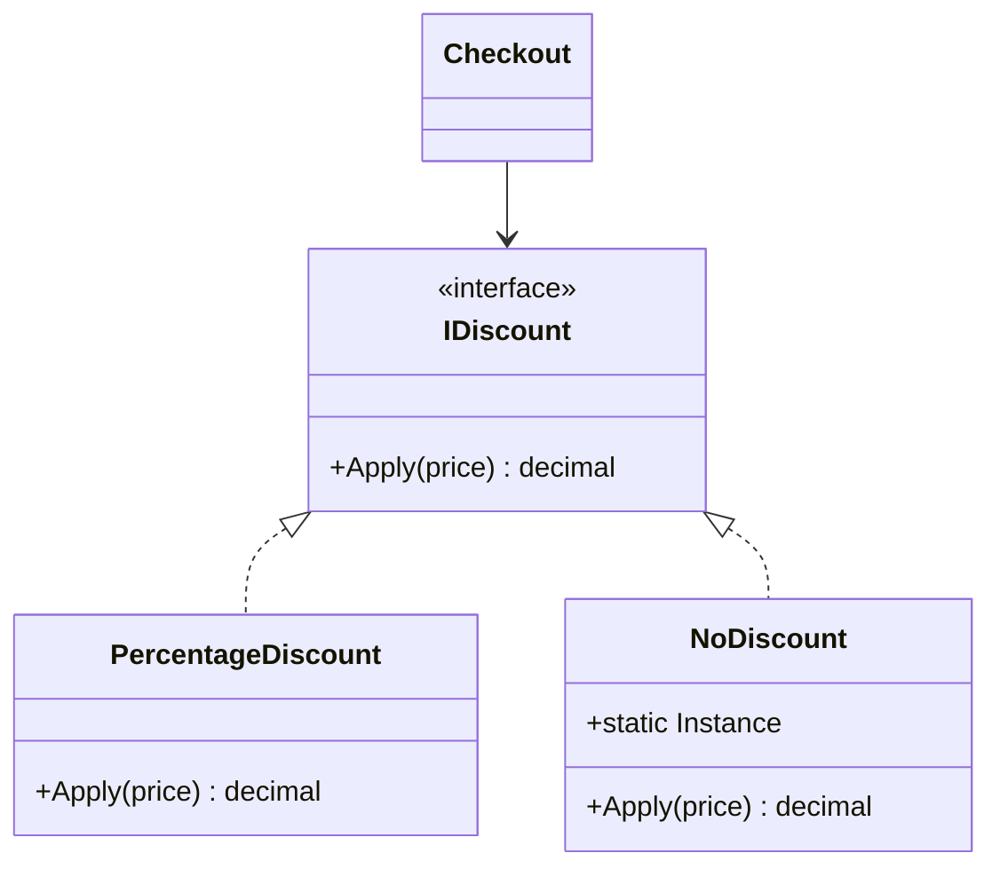

> [!summary] TL;DR
> Instead of returning null and forcing every caller to check, return an object whose methods are safe no-ops: a logger that discards messages, an empty discount. `NullLogger<T>.Instance` and `Enumerable.Empty<T>()` are .NET examples.

## Problem
- Null checks are repeated everywhere an optional collaborator is used, and a missed one causes a `NullReferenceException`.

## Solution
- Create a class implementing the interface with neutral behavior (no-op, zero, empty).
- Return or inject it wherever "nothing" is a valid option.
- Usually make it a shared immutable instance.
- Use nullable reference types for cases where absence must be handled explicitly.

## Structure

![[Pasted image 20260607165417.png]]

## When to use / when not to
| Use when | Avoid when |
| --- | --- |
| "Do nothing" is a valid behavior for an optional collaborator | Absence is an error the caller must notice (a null object would hide it) |
| Removing repetitive null checks (loggers, notifiers, policies) | Callers need to distinguish "missing" from "present but neutral" |

## Trade-offs
| Pro | Con |
| --- | --- |
| Fewer null checks and null bugs | Can hide errors that should be visible |
| Simpler, polymorphic client code | Another class per interface |

## Related patterns
- **Alternatives:** nullable reference types with explicit checks; Option/Maybe types; [[Result Pattern]]
- **Often combined with:** [[Strategy Pattern]] (a do-nothing strategy); [[Singleton Pattern]] (shared instance); [[State Pattern]]
- **Anti-pattern to watch for:** [[Error Hiding]] (a null object masking a real failure)
- Catalog: [[Software Design Patterns & Anti Patterns#Behavioral|Behavioral patterns]].
