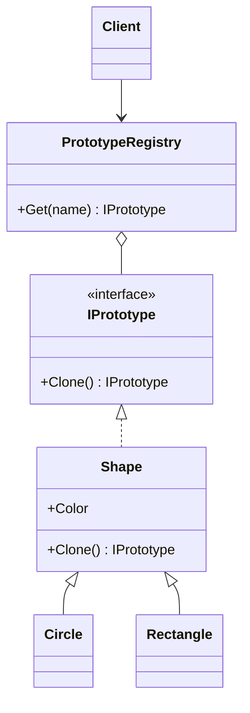

> [!summary] TL;DR
> Keep a ready-configured instance and clone it whenever you need another one like it. The client needs only the prototype, not its concrete class, and cloning skips expensive set-up. C# records with `with` expressions are a lightweight built-in form.

## Problem
- Setting up an object is expensive or complex (loaded from config, computed defaults).
- The code that creates objects shouldn't depend on their concrete classes, which may be chosen at runtime.

## Solution
- Give products a `Clone()` method (or use record `with` expressions).
- Keep a registry of named prototypes, configured once.
- Clients ask the registry for a prototype and clone it, then adjust the copy.
- Decide deliberately between shallow and deep copy for each field.

## Structure

![[Pasted image 20260607084635.png]]

## When to use / when not to
| Use when | Avoid when |
| --- | --- |
| Instances differ only slightly from a few standard configurations | Objects have complex graphs with cycles where deep copy is error-prone |
| Construction is expensive compared to copying | Construction is cheap and clear |
| Classes to instantiate are chosen at runtime |  |

## Trade-offs
| Pro | Con |
| --- | --- |
| Avoids repeating expensive initialization | Correct deep cloning is hard (references, cycles, resources) |
| Adds and removes product kinds at runtime | `ICloneable` in .NET doesn't say whether the copy is deep or shallow |
| Hides concrete classes from clients |  |

## Related patterns
- **Alternatives:** [[Factory Method]]; [[Abstract Factory]]; [[Builder Pattern]]
- **Often combined with:** [[Memento Pattern]] (snapshots by copying); [[Composite Pattern]] (cloning trees); [[Flyweight Pattern]]
- **Anti-pattern to watch for:** [[Action at a Distance]] (shallow copies sharing mutable state)
- Catalog: [[Software Design Patterns & Anti Patterns#Creational|Creational patterns]].
