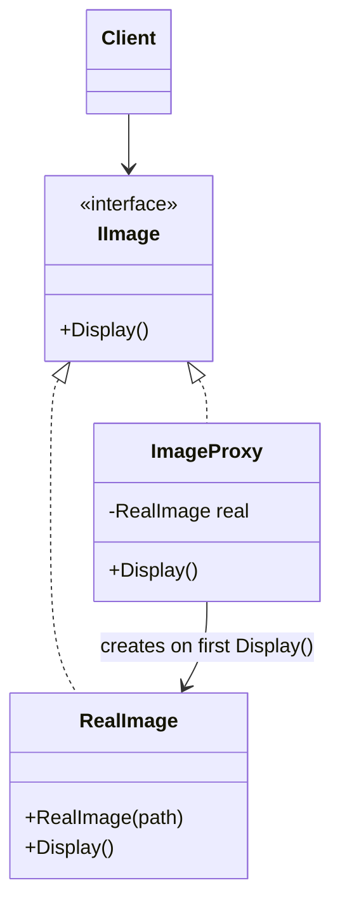

> [!summary] TL;DR
> A proxy stands in for the real subject and implements the same interface, so the client can't tell the difference. It decides when and whether to forward calls: create the real object lazily (virtual proxy), call across the network (remote proxy), check permissions (protection proxy) or cache results (caching proxy).

## Problem
- The real object is expensive to create, lives elsewhere, or needs access control, but clients shouldn't have to handle that.

## Solution
- Define a subject interface shared by the real object and the proxy.
- The proxy holds (or creates) the real subject and forwards calls after doing its job.
- Clients depend on the interface and receive the proxy.

## Structure

![[Pasted image 20260607084905.png]]

## When to use / when not to
| Use when | Avoid when |
| --- | --- |
| Lazy creation of expensive objects (virtual proxy) | Remote proxies that hide latency and failure the caller must handle (see [[Fallacies of Distributed Computing]]) |
| Hiding remote calls behind a local interface (gRPC/WCF client stubs) | The extra layer adds nothing measurable |
| Access control, caching or logging around an object |  |

## Trade-offs
| Pro | Con |
| --- | --- |
| Transparent to clients | Added latency and indirection |
| Controls lifecycle and access of the real object | Can hide important behavior (network calls look local) |

## Related patterns
- **Alternatives:** [[Decorator Pattern]] (adds behavior; a proxy controls access); [[Adapter Pattern]] (changes the interface)
- **Often combined with:** [[Lazy Initialization]]; [[Resource Acquisition Is Initialization]]; [[Caching Patterns]]
- **Anti-pattern to watch for:** [[Lasagna Code]]
- Catalog: [[Software Design Patterns & Anti Patterns#Structural|Structural patterns]].
