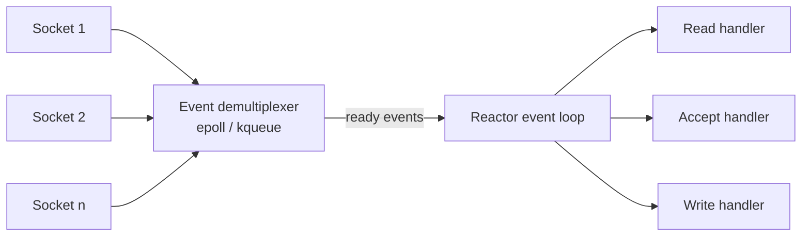

> [!summary] TL;DR
> Instead of a thread per connection, one event loop asks the OS which handles are ready (epoll, kqueue, IOCP-style notifications) and calls the matching handler for each. Handlers must not block. Node.js, Nginx and Netty are reactor-based; ASP.NET Core's Kestrel uses async I/O with similar goals.

## Problem
- A thread per connection doesn't scale to tens of thousands of mostly idle connections.
- Each blocked thread costs memory and context switches.

## Solution
- Register handlers for I/O handles with a **reactor**.
- The reactor's loop waits on a **synchronous event demultiplexer** (`select`, `epoll`).
- When a handle becomes ready, the reactor dispatches to its handler.
- Handlers do short, non-blocking work and return to the loop; long work goes to a thread pool.

## Structure

![[Pasted image 20260607170712.png]]

## When to use / when not to
| Use when | Avoid when |
| --- | --- |
| High-concurrency network servers with many idle connections | CPU-heavy handlers (they stall the loop) |
| I/O-bound workloads | Blocking libraries that can't be made non-blocking |

## Trade-offs
| Pro | Con |
| --- | --- |
| Scales to many connections with few threads | One blocking handler stalls everything |
| No locking needed inside single-threaded handlers | Callback-style code is harder to follow |
|  | Doesn't use multiple cores without several loops |

## Related patterns
- **Alternatives:** thread-per-connection ([[Service Handler Pattern]]); proactor (completion-based async I/O)
- **Often combined with:** [[Thread Pool]] (offload CPU work); [[Event-Driven Architecture]]; [[Reactive Architecture]]
- **Anti-pattern to watch for:** [[Busy Waiting]]
- Catalog: [[Software Design Patterns & Anti Patterns#Concurrency|Concurrency patterns]].
