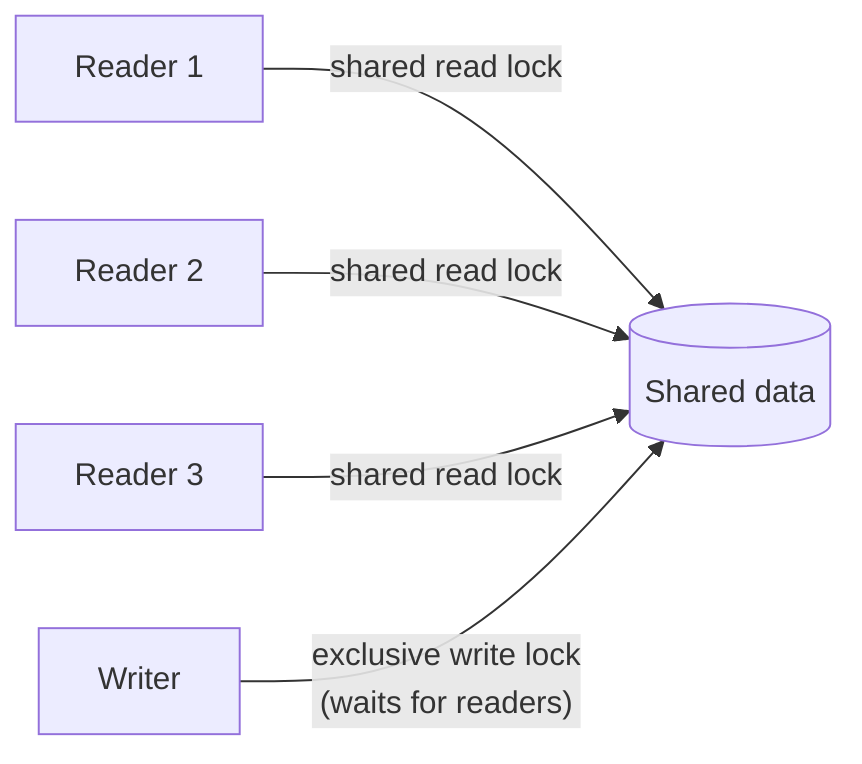

> [!summary] TL;DR
> Readers share the lock; a writer waits until all readers leave and then blocks everyone else until it finishes. It pays off when reads vastly outnumber writes and read sections are non-trivial. In .NET, `ReaderWriterLockSlim` implements it; for many cases, immutable snapshots swapped atomically are simpler.

## Problem
- A plain lock serializes readers too, even though concurrent reads are safe.
- Read-mostly caches and configuration become bottlenecks.

## Solution
- Readers acquire a shared (read) lock; any number can hold it.
- Writers acquire an exclusive (write) lock, waiting for readers to drain.
- Choose a fairness policy so writers aren't starved.
- Optionally support upgradeable read locks for read-then-maybe-write logic.

## Structure

## When to use / when not to
| Use when | Avoid when |
| --- | --- |
| Read-heavy shared data with occasional writes | Short critical sections (a plain lock is faster) |
| Read sections long enough that lock overhead matters | Write-heavy data |
|  | Async code (`ReaderWriterLockSlim` is thread-affine) |

## Trade-offs
| Pro | Con |
| --- | --- |
| Concurrent reads improve throughput | Higher overhead per acquisition than a simple lock |
|  | Writer starvation or reader starvation depending on policy |
|  | Upgrade deadlocks |

## Related patterns
- **Alternatives:** [[Lock Pattern]]; immutable snapshots with copy-on-write and an atomic swap; concurrent collections
- **Often combined with:** [[Monitor Object]]; [[Caching Patterns]]
- **Anti-pattern to watch for:** [[Premature Optimization]] (an RW lock where a plain lock was fine)
- Catalog: [[Software Design Patterns & Anti Patterns#Concurrency|Concurrency patterns]].
