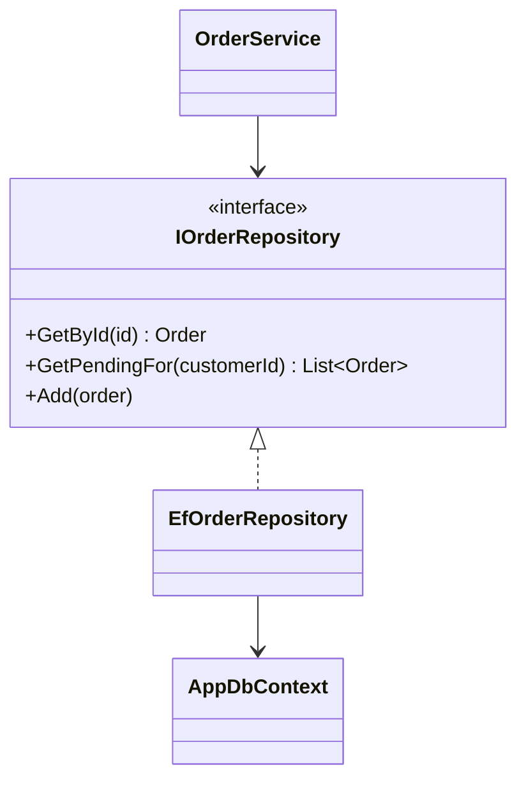

> [!summary] TL;DR
> A repository looks like an in-memory collection of domain objects (`GetById`, `Add`, `Remove`, a few intention-revealing queries) and hides the persistence technology behind it. It keeps business logic independent of the database. With EF Core, `DbContext` and `DbSet` already implement repository and unit of work, so a generic wrapper on top often adds little.

## Problem
- Business logic that builds SQL or ORM queries directly is coupled to the database and hard to unit test.
- The same query logic gets repeated across services and drifts.

## Solution
- Define one repository interface per aggregate root, in domain terms (`IOrderRepository.GetPendingFor(customerId)`).
- Implement it in the infrastructure layer with the ORM or SQL of choice.
- Keep transactions in a unit of work (in EF Core, `SaveChanges`) rather than in each repository method.
- Prefer specific query methods (or [[Specification Pattern]] objects) over exposing `IQueryable`, which leaks persistence concerns.

## Structure

## When to use / when not to
| Use when | Avoid when |
| --- | --- |
| Domain logic is rich and should not depend on the persistence technology | A generic `IRepository<T>` over EF Core that only forwards to `DbSet` (see [[7 .NET Habits to Reconsider]]) |
| Queries for an aggregate are reused across several use cases | Simple CRUD or reporting where queries are one-off and projection-heavy |
| You need to swap or fake persistence in tests |  |

## Trade-offs
| Pro | Con |
| --- | --- |
| Domain code is persistence-ignorant | Another abstraction layer to maintain |
| Query logic lives in one place per aggregate | Generic repositories hide useful ORM features (projections, includes, tracking) |
| Easy to substitute in tests | Leaky if it exposes `IQueryable` |

## Related patterns
- **Alternatives:** direct `DbContext` use in handlers; [[CQRS]] read models with raw queries for the read side
- **Often combined with:** Unit of Work; [[Specification Pattern]]; [[Dependency Injection]]; [[Clean Architecture]] (interface in the core, implementation in infrastructure)
- **Anti-pattern to watch for:** [[Anemic Domain Model]]; [[Lasagna Code]] (repository over a DbContext that is already a repository)
- Context: [[7 .NET Habits to Reconsider]], [[EF Core Cheat Sheet]]
- Catalog: [[Software Design Patterns & Anti Patterns#Enterprise application patterns|Enterprise application patterns]].
