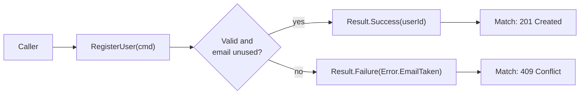

> [!summary] TL;DR
> An operation returns a `Result<T>` that is either a success with a value or a failure with error details. Expected failures (validation, not found, business-rule violations) become part of the method signature rather than hidden exceptions. Exceptions remain for truly exceptional conditions.

## Problem
- Using exceptions for expected outcomes (invalid input, missing record) hides control flow, costs performance and makes signatures lie about what can happen.
- Returning null or magic values loses the reason for the failure.

## Solution
- Define `Result` / `Result<T>` with `IsSuccess`, `Value` and `Error` (or a list of errors).
- Return failures for expected outcomes; keep exceptions for bugs and infrastructure faults.
- Provide helpers to compose results (`Map`, `Bind`, `Match`) and to map them to HTTP responses at the edge.
- Use typed error codes so callers can branch on them.

## Structure

## When to use / when not to
| Use when | Avoid when |
| --- | --- |
| Expected business failures that callers should handle | Truly exceptional or unrecoverable faults (let exceptions propagate) |
| Validation results with several errors | Teams that will ignore `IsSuccess` checks anyway |
| Hot paths where exception cost matters |  |

## Trade-offs
| Pro | Con |
| --- | --- |
| Failures are explicit in signatures | More verbose call sites without language support |
| No exception overhead for expected cases | Easy to ignore a returned failure |
| Composable error handling | Mixing results and exceptions needs clear rules |

## Related patterns
- **Alternatives:** exceptions; Option/Maybe types; [[Null Object]]
- **Often combined with:** [[Pipeline Pattern]] (validation behaviors returning failures); [[Command Pattern]]; [[Specification Pattern]]
- **Anti-pattern to watch for:** [[Error Hiding]]; [[Coding by Exception]]
- Catalog: [[Software Design Patterns & Anti Patterns#Behavioral|Behavioral patterns]].
