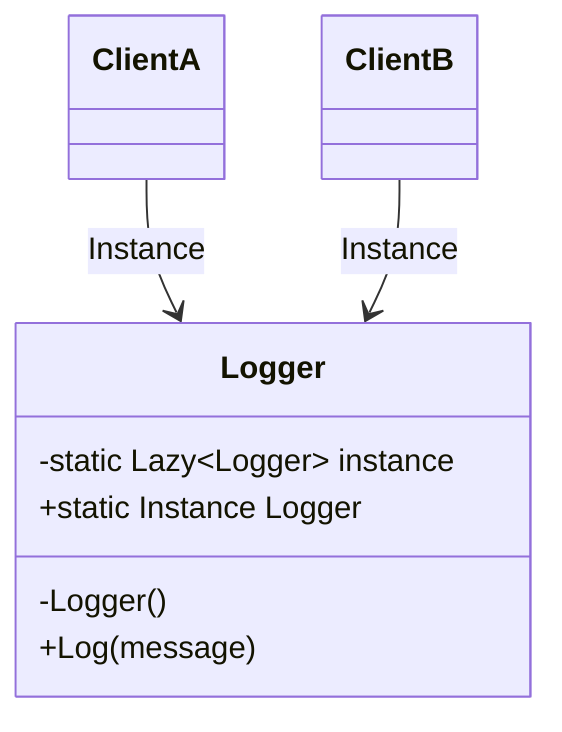

> [!summary] TL;DR
> A class controls its own instantiation so only one instance ever exists, reachable from anywhere. It fits truly single resources, but a static singleton is global mutable state that hides dependencies and hurts testing. In .NET, registering a service with a singleton *lifetime* in DI usually gives the benefit without the drawbacks.

## Problem
- Some resources must exist exactly once per process (a configuration snapshot, a hardware handle, an in-memory cache).
- Letting every caller create its own copy wastes resources or causes conflicting state.

## Solution
- Make the constructor private.
- Expose a static `Instance` that creates the single instance lazily and thread-safely (`Lazy<T>` or a static initializer).
- Prefer registering the class as a singleton lifetime in the DI container and injecting it.

## Structure

![[Pasted image 20260607084656.png]]

## When to use / when not to
| Use when | Avoid when |
| --- | --- |
| Exactly one instance is required by the problem, not just convenient | You want global access out of convenience (it becomes hidden coupling) |
| The instance is stateless or its state is safe to share | Unit tests need to replace the instance |
|  | You're in a DI-based app: use a singleton lifetime instead |

## Trade-offs
| Pro | Con |
| --- | --- |
| Controlled single instance | Global mutable state and hidden dependencies |
| Lazy creation | Hard to test and to run tests in parallel |
|  | Concurrency issues if state is mutable |

## Related patterns
- **Alternatives:** singleton lifetime in [[Dependency Injection]]; [[Multiton Pattern]]; static class for pure functions
- **Often combined with:** [[Abstract Factory]]; [[Facade Pattern]]; [[Lazy Initialization]]
- **Anti-pattern to watch for:** [[God Object]]; [[Action at a Distance]]; [[Double-Checked Locking]] done by hand
- Catalog: [[Software Design Patterns & Anti Patterns#Creational|Creational patterns]].
