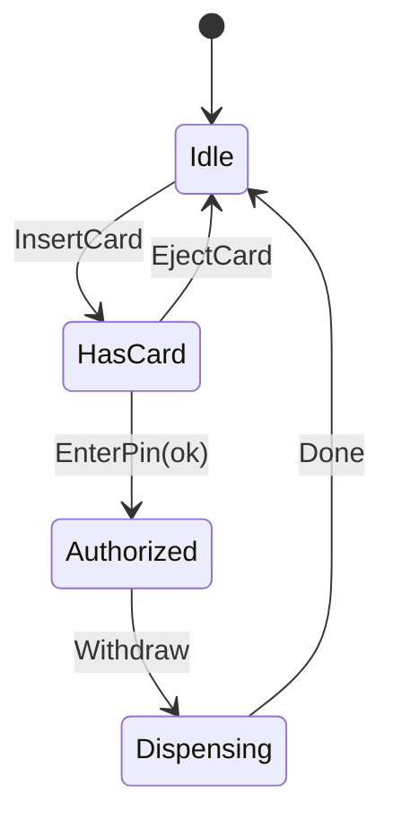

> [!summary] TL;DR
> Each state (Idle, HasCard, Dispensing) is a class implementing the same interface, and the context delegates to its current state object, which also decides the next state. This replaces large `switch` statements on a status field with polymorphism.

## Problem
- An object's behavior depends on its state, leading to `switch (status)` blocks repeated in every method.
- Adding a state means editing every one of those blocks.

## Solution
- Define a state interface with the operations that vary by state.
- Implement one class per state.
- The context holds the current state and delegates calls to it.
- States trigger transitions by setting the context's next state.

## Structure

![[Pasted image 20260607165535.png]]

## When to use / when not to
| Use when | Avoid when |
| --- | --- |
| Behavior varies by state and state changes at runtime | Two or three states with trivial behavior (an enum and a switch is clearer) |
| Conditionals on state are duplicated across methods | Transitions are data-driven (use a state machine library or table) |
| State transitions follow clear rules (workflows, protocols, devices) |  |

## Trade-offs
| Pro | Con |
| --- | --- |
| Each state's behavior in one place | More classes |
| Adding states doesn't touch other states | Transition logic spread across states can be hard to see as a whole |
| Transitions are explicit |  |

## Related patterns
- **Alternatives:** enum plus switch; table-driven state machines (e.g. Stateless library); [[Strategy Pattern]]
- **Often combined with:** [[Flyweight Pattern]] (shared stateless states); [[Singleton Pattern]]; [[Request State Management]]
- **Anti-pattern to watch for:** [[Loop-Switch Sequence]]; [[Coding by Exception]]
- Catalog: [[Software Design Patterns & Anti Patterns#Behavioral|Behavioral patterns]].
