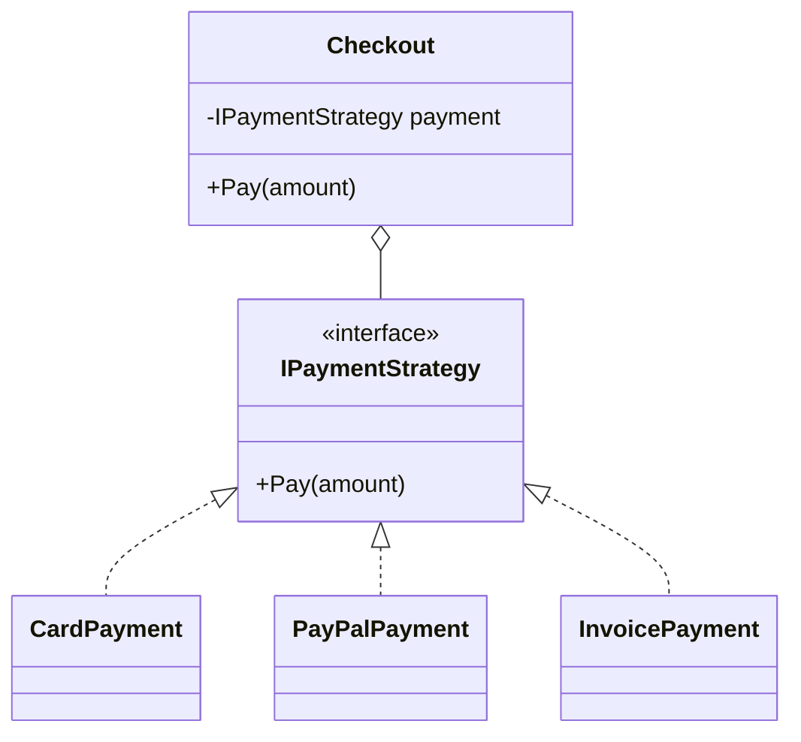

> [!summary] TL;DR
> Put each algorithm (payment method, pricing rule, compression) in its own class behind a common interface, and let the client hold whichever one it's given. With DI, strategies are injected, or a resolver picks one by key. It replaces conditionals that choose behavior.

## Problem
- A class picks between several algorithms with `if/switch`, and adding one means changing the class.
- Algorithms can't be tested or reused independently.

## Solution
- Define a strategy interface for the algorithm.
- Implement each variant as a class.
- The context receives a strategy (constructor, method parameter) and calls it.
- With DI, register all strategies and select by key (`IEnumerable<IPaymentStrategy>` or keyed services).

## Structure

![[Pasted image 20260607085123.png]]

## When to use / when not to
| Use when | Avoid when |
| --- | --- |
| Several variants of an algorithm, chosen at runtime or by configuration | Only one algorithm, or variants that never change |
| Removing behavior-selecting conditionals | A lambda (`Func<>`) would do |
| Algorithms need isolated tests |  |

## Trade-offs
| Pro | Con |
| --- | --- |
| Open/closed: add strategies without changing the context | Clients or a resolver must know which strategy to choose |
| Testable algorithms | More classes |
| Runtime selection |  |

## Related patterns
- **Alternatives:** delegates (`Func<>`); [[Template Method]] (inheritance-based variation); [[State Pattern]] (strategy that changes itself)
- **Often combined with:** [[Dependency Injection]]; [[Factory Method]] (choosing strategies); [[Null Object]]; [[Decorator Pattern]]
- **Anti-pattern to watch for:** [[Golden Hammer]] (a strategy interface for every if statement)
- Catalog: [[Software Design Patterns & Anti Patterns#Behavioral|Behavioral patterns]].
