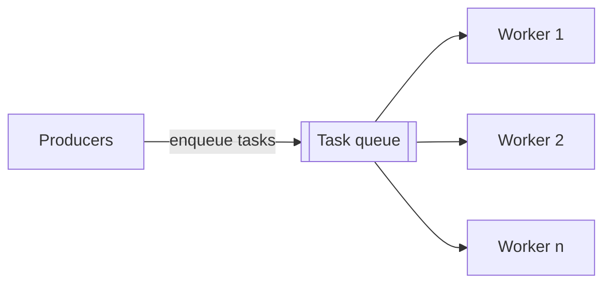

> [!summary] TL;DR
> Tasks go into a queue and a pool of reusable worker threads pulls and runs them. Creating threads is expensive, so reusing them improves throughput and caps concurrency. The .NET `ThreadPool` runs `Task.Run`, async continuations and ASP.NET Core requests; it's a special case of [[Object Pool]].

## Problem
- Creating a thread per short task wastes time and memory and can overwhelm the machine.

## Solution
- Create worker threads up front or on demand, up to a limit.
- Queue tasks; idle workers dequeue and execute them.
- Size the pool for the workload (CPU-bound: about the core count; I/O-bound: use async I/O rather than more threads).
- Never block pool threads on synchronous waits (thread-pool starvation).

## Structure

![[Pasted image 20260607171014.png]]

## When to use / when not to
| Use when | Avoid when |
| --- | --- |
| Many short, independent tasks | Long-running or blocking work (use a dedicated thread or `TaskCreationOptions.LongRunning`) |
| Server request processing | Work needing thread affinity (UI threads) |
| Bounding concurrency |  |

## Trade-offs
| Pro | Con |
| --- | --- |
| Amortizes thread creation | Starvation from blocking calls (`.Result`, `.Wait()`) |
| Bounded resource use | Shared pool means noisy neighbors |
| Built into the runtime | Harder to reason about ordering |

## Related patterns
- **Alternatives:** [[Service Handler Pattern]] (thread per session); [[Reactor Pattern]]
- **Often combined with:** [[Guarded Suspension]] (the work queue); [[Supervisor Consumer Pattern]]; [[Thread Delegate Pattern]]; [[Compute Kernel]]
- **Anti-pattern to watch for:** [[Busy Waiting]]; [[Premature Optimization]] (custom pools in place of the runtime's)
- Catalog: [[Software Design Patterns & Anti Patterns#Concurrency|Concurrency patterns]].
