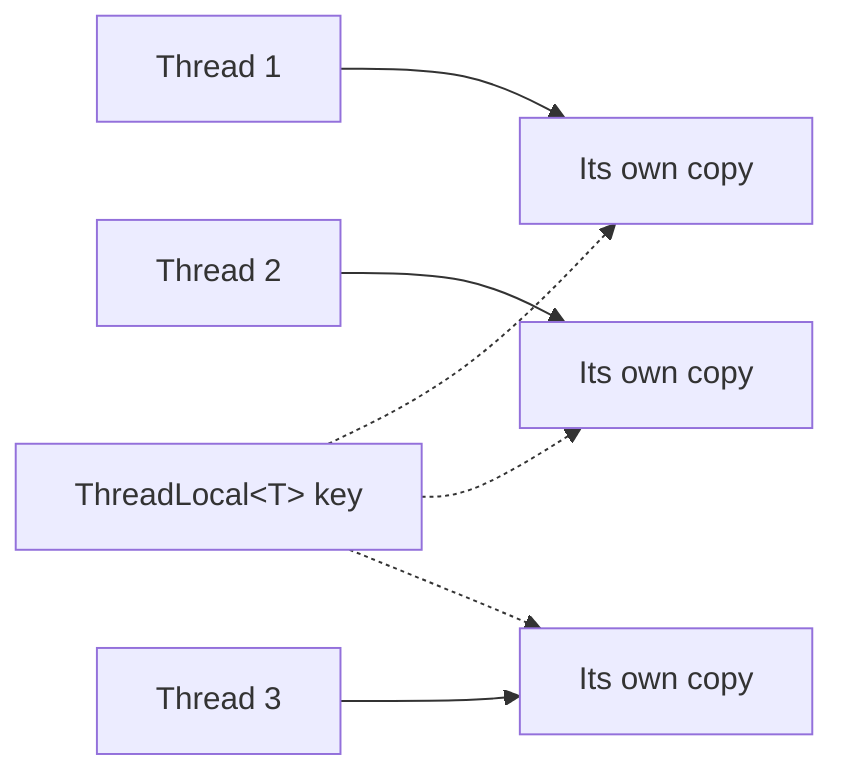

> [!summary] TL;DR
> Data that would otherwise be shared, such as a buffer, a random-number generator or a request context, is kept per thread, so no synchronization is needed. In .NET, `[ThreadStatic]` and `ThreadLocal<T>` give per-thread storage, while `AsyncLocal<T>` follows the logical async flow, which is usually what server code wants.

## Problem
- Shared objects that aren't thread-safe (like `Random` in older .NET) need locks on every use.
- Passing context (user, correlation ID) through every method signature is noisy.

## Solution
- Declare the variable as thread-local (`ThreadLocal<T>`, `[ThreadStatic]`).
- Each thread lazily initializes and uses its own instance.
- For async code, use `AsyncLocal<T>` so the value follows the logical flow across `await`.
- Clean up per-thread values on pooled threads.

## Structure

## When to use / when not to
| Use when | Avoid when |
| --- | --- |
| Per-thread caches or non-thread-safe helpers | Async code with `[ThreadStatic]` (values don't follow the continuation) |
| Ambient context such as correlation IDs (with `AsyncLocal<T>`) | As a hidden way to pass required parameters |

## Trade-offs
| Pro | Con |
| --- | --- |
| No locks for per-thread state | Hidden dependencies and ambient state |
| Less parameter plumbing | Leaks on pooled threads |
|  | Memory per thread |

## Related patterns
- **Alternatives:** passing context explicitly; [[Lock Pattern]] around a shared instance
- **Often combined with:** [[Service Handler Pattern]]; [[CPU Atomic Operation]] (merge per-thread counters); [[Logging Best Practices]] (scoped context)
- **Anti-pattern to watch for:** [[Action at a Distance]]
- Catalog: [[Software Design Patterns & Anti Patterns#Concurrency|Concurrency patterns]].
