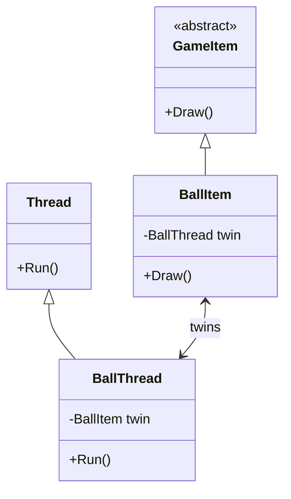

> [!summary] TL;DR
> When a class needs to be both a `GameItem` and a `Thread`, create two twin classes, one per parent, linked to each other. Each twin handles its parent's protocol and delegates the rest to its sibling, so the pair behaves like one object.

## Problem
- A class needs to inherit from two base classes (for example, a framework class and a domain base class), but the language allows only one.

## Solution
- Create one twin subclass per parent class.
- Each twin holds a reference to the other.
- Each twin overrides its parent's methods and forwards anything that belongs to its sibling.
- Create and link both twins together (a factory helps).

## Structure

![[Pasted image 20260607124631.png]]

## When to use / when not to
| Use when | Avoid when |
| --- | --- |
| You must extend two framework base classes at once | Interfaces (with default methods) or composition can do it, which is usually the case in C# |
| Interfaces and composition can't express the requirement |  |

## Trade-offs
| Pro | Con |
| --- | --- |
| Emulates multiple inheritance without language support | Two objects to keep in sync |
| Each twin stays cohesive around one parent | Object identity is split; easy to leak one twin |

## Related patterns
- **Alternatives:** interfaces; [[Delegation Pattern]]; composition
- **Often combined with:** [[Delegation Pattern]]
- **Anti-pattern to watch for:** [[Circle-Ellipse Problem]] (inheritance that doesn't fit)
- Catalog: [[Software Design Patterns & Anti Patterns#Structural|Structural patterns]].
